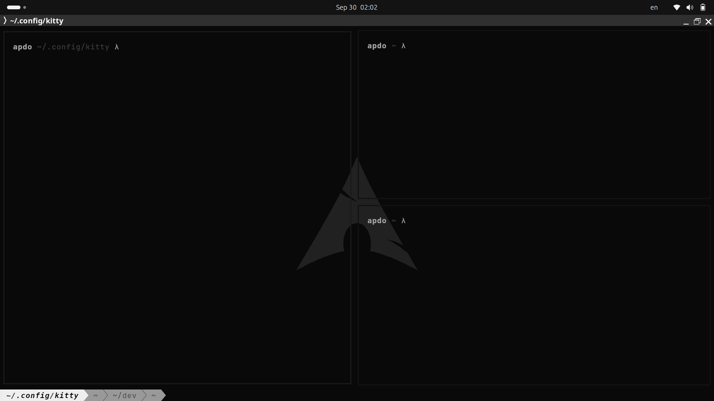

# kitty-config

This is the terminal setup I use every day on Linux, built around [kitty](https://sw.kovidgoyal.net/kitty/) with a custom [Starship](https://starship.rs/) prompt.

(I USE UBUNTU BUT THE SCREENSHOT IS FOR THE LARP)

## Contents

- `kitty.conf`: my kitty configuration
- `kittyBG/`: background images used by the terminal
- `starship.toml`: the command prompt config (the `apdo ~ λ` look)

## Usage

Clone the repo into your kitty config folder:

```bash
git clone https://github.com/Apdoxdd/kitty-config.git ~/.config/kitty
```

The prompt config is included in the repo. Starship reads it from `~/.config/starship.toml`, so copy it there:

```bash
cp ~/.config/kitty/starship.toml ~/.config/starship.toml
```

Make sure Starship is installed and enabled in your `~/.bashrc`:

```bash
eval "$(starship init bash)"
```

Then restart kitty, or press `ctrl+shift+f5` to reload the config.
